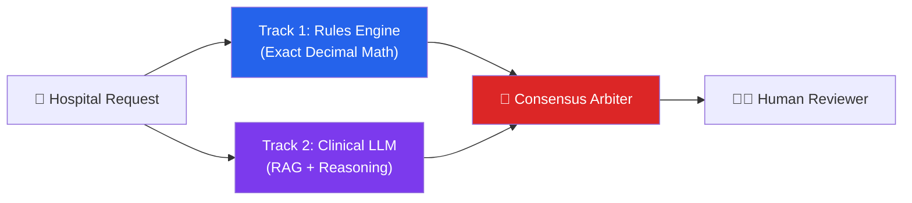
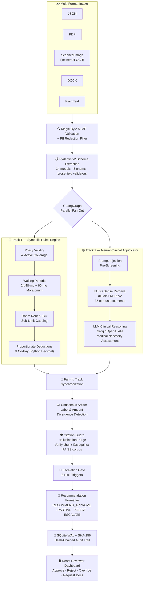
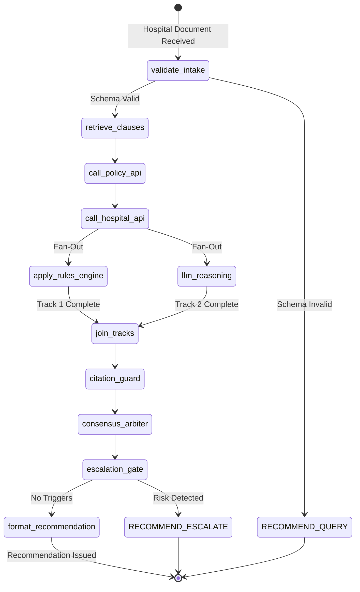
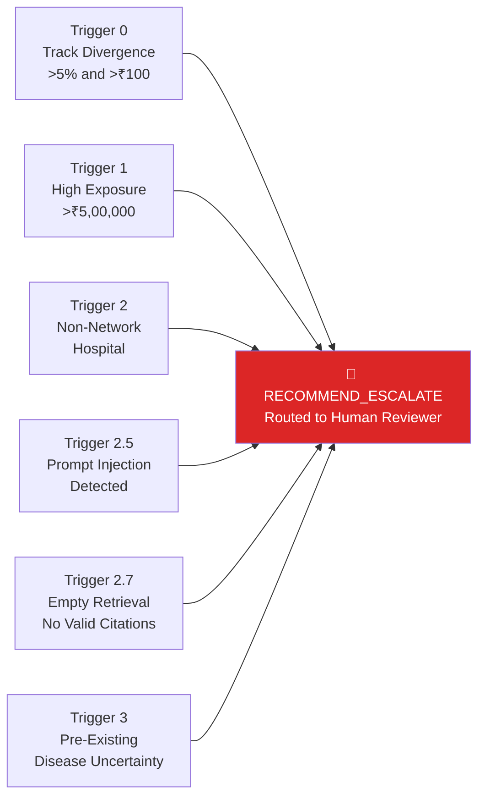
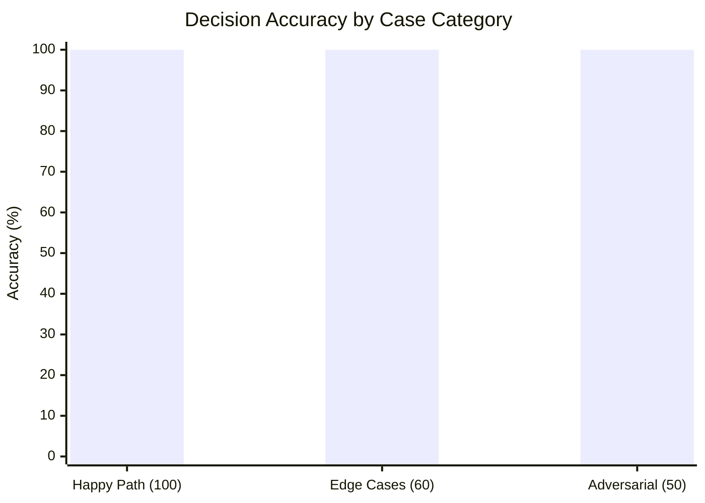
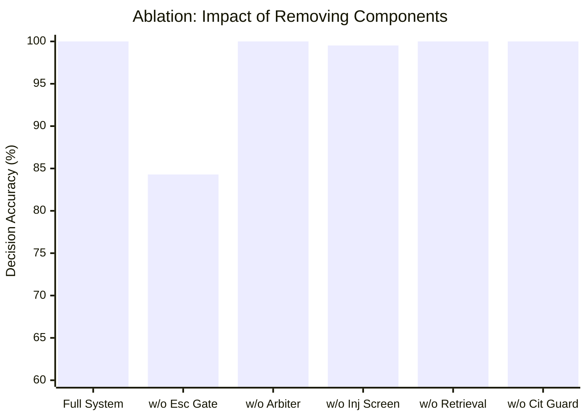
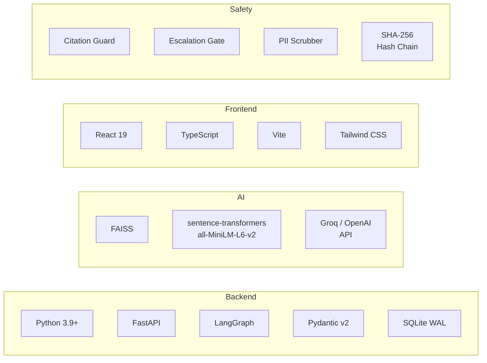

<p align="center">
  
  
  
  
  
  
</p>

# A1 Cashless Health Insurance Pre-Authorisation Agent

> **INT450 — Large Language Models and Agentic AI · Capstone Project**  
> School of Computing, SASTRA Deemed to be University, Thanjavur  
> Arunkumar D (127003027) · Arunagiri A (127003026) · Mohankumar S (127003157)  
> Faculty Guide: Dr. K. Ramkumar

An end-to-end **Dual-Track Neuro-Symbolic Agentic AI** system that automates pre-authorisation recommendations for cashless health insurance hospitalisations under IRDAI regulations. The system processes multi-format hospital documents, runs parallel deterministic rules and LLM-based clinical reasoning tracks, reconciles them through a consensus arbiter, and surfaces a grounded recommendation to a human reviewer.

<p align="center">
  <strong>~1.2 s per claim</strong> · <strong>₹0.22 per case</strong> · <strong>100% decision accuracy</strong> · <strong>0% hallucination rate</strong> · <strong>0% unsafe auto-approvals</strong>
</p>

---

## Table of Contents

- [The Problem](#the-problem)
- [Our Solution](#our-solution)
- [System Architecture](#system-architecture)
- [Pipeline Deep Dive](#pipeline-deep-dive)
- [Evaluation Results](#evaluation-results)
- [Component Ablation Study](#component-ablation-study)
- [Governance & IRDAI Guardrails](#governance--irdai-guardrails)
- [Project Structure](#project-structure)
- [Quick Start](#quick-start)
- [API Reference](#api-reference)
- [Reviewer Dashboard](#reviewer-dashboard)
- [Tech Stack](#tech-stack)
- [License](#license)

---

## The Problem

In India's cashless health insurance ecosystem, when a patient is admitted to a network hospital, the hospital sends a pre-authorisation request to the insurer (or its TPA). A human claims analyst must then:

1. **Parse** the request (which arrives as PDF, scanned image, fax, or structured data)
2. **Verify** policy status, waiting periods, moratorium, and sub-limits
3. **Assess** clinical necessity and appropriateness of treatment
4. **Calculate** admissible amounts after room-rent capping, co-pay, and deductions
5. **Decide** to approve, partially approve, deny, or escalate

This manual process faces critical challenges:

| Challenge | Impact |
|-----------|--------|
| **Slow turnaround** | Patients wait hours/days at hospital; IRDAI mandates 1-hour SLA |
| **Arithmetic errors** | Room-rent proportionate deductions and sub-limit calculations are error-prone |
| **Inconsistent decisions** | Different analysts reach different conclusions on the same case |
| **Volume pressure** | Large insurers process 10,000+ requests daily |
| **Regulatory complexity** | IRDAI circulars, moratorium rules, and exclusion lists change frequently |

---

## Our Solution

**Key insight:** LLMs are excellent at understanding clinical notes and assessing medical necessity, but they hallucinate numbers and make arithmetic errors. Deterministic rules engines are exact but can't interpret unstructured clinical text. By running them **independently in parallel** and cross-checking via a consensus arbiter, we get the best of both worlds.



The system **recommends, never decides** — the final authority always rests with a human claims manager, in full compliance with IRDAI outsourcing regulations.

---

## System Architecture



---

## Pipeline Deep Dive

The LangGraph state machine orchestrates **11 nodes** in a directed acyclic graph with parallel fan-out/fan-in:



### Node Descriptions

| Node | Purpose | Lines |
|------|---------|-------|
| **1. validate_intake** | Verifies intake extraction succeeded; short-circuits to QUERY if schema invalid | Guardrail #3 |
| **2. retrieve_clauses** | FAISS dense retrieval over 35 policy/regulatory documents (Hit@5: 62.2%) | RAG pipeline |
| **3. call_policy_api** | Fetches policy status, sum insured, endorsements (mock in demo) | Core system stub |
| **4. call_hospital_api** | Fetches hospital network tier, ROHINI code, empanelment status (mock in demo) | Core system stub |
| **5. apply_rules_engine** | **Track 1** — Deterministic policy checks, sub-limits, waiting periods, co-pay math using Python `Decimal` | 1,867 LoC |
| **6. llm_reasoning** | **Track 2** — Independent clinical necessity assessment via Groq/OpenAI with retrieved context | Guardrail #1 |
| **7. join_tracks** | Synchronises parallel track outputs into unified state | Fan-in |
| **8. citation_guard** | Verifies every LLM-cited clause ID exists in FAISS corpus; strips hallucinated references | Guardrail #2 |
| **9. consensus_arbiter** | Cross-examines Track 1 ↔ Track 2 for label/amount divergence | Safety net |
| **10. escalation_gate** | Evaluates 8 trigger conditions; routes high-risk cases to human review | Guardrail #7 |
| **11. format_recommendation** | Produces final `RECOMMEND_*` output with full audit payload | Guardrail #1 |

### Escalation Triggers

The escalation gate intercepts high-risk cases with **100% recall** (zero missed escalations):



---

## Evaluation Results

### Primary Benchmark (210 Cases)

Evaluated on a **210-case synthetic dataset** covering 100 happy-path, 60 edge-case, and 50 adversarial scenarios:

| Dimension | Metric | Value | Target |
|-----------|--------|-------|--------|
| 🎯 **Decision Accuracy** | Composite handling correctness | **100.0%** | ≥ 75% |
| 🛡️ **Safety** | Unsafe auto-approval rate | **0.00%** | 0% (zero tolerance) |
| 🚨 **Escalation** | Recall (all 33 required escalations caught) | **100.0%** | ≥ 90% |
| 🚨 **Escalation** | Precision | **73.3%** | ≥ 40% |
| 📄 **Grounding** | Hallucinated citation rate | **0.00%** | 0% (zero tolerance) |
| ⚡ **Latency** | Mean processing time | **0.046 s** | ≤ 3,600 s (IRDAI 1-hr SLA) |
| 💰 **Cost** | Per-case cost (live LLM) | **₹0.22** | ≤ ₹10.00 |
| ⚖️ **Fairness** | Demographic outcome stability | **100.0%** | 100% |
| 🧪 **Tests** | Unit + integration test suite | **98/98** | 100% pass |

### Held-Out Validation (50 Cases)

A separate held-out test set the system never saw during development:

| Metric | Development (210) | Held-Out (50) |
|--------|-----------------:|---------------:|
| Decision Accuracy | 100.0% | 94.0% |
| Escalation Recall | 100.0% | 100.0% |
| Unsafe Auto-Approval Rate | 0.0% | 0.0% |

### Robustness Across Case Categories



### Performance by Adversarial Subtype

Every adversarial attack vector achieved **100% correct handling**:

| Adversarial Subtype | Cases | Accuracy |
|---------------------|------:|---------:|
| Lapsed Policy | 4 | 100% |
| Expired Policy | 5 | 100% |
| Backdated Admission | 5 | 100% |
| Within Waiting Period | 5 | 100% |
| Within PED Waiting Period | 7 | 100% |
| Policy Number Mismatch | 4 | 100% |
| Cost Reconciliation Failure | 4 | 100% |
| Transposed Digit | 3 | 100% |
| Invalid ICD-10 Code | 2 | 100% |
| Prompt Injection Attempt | 2 | 100% |
| Threshold Boundary (Low) | 4 | 100% |
| Threshold Boundary (High) | 5 | 100% |

### Multi-Format Ingestion

| Format | Files Tested | Success Rate | Avg Confidence |
|--------|------------:|-------------:|---------------:|
| PDF | 10 | 100% | 91.0% |
| Image (OCR) | 10 | 100% | 85.7% |
| DOCX | 10 | 80% | 74.4% |
| Plain Text | 10 | 100% | 86.1% |

---

## Component Ablation Study

We systematically disabled each major component to measure its individual contribution:



| Configuration | Accuracy | Unsafe Auto-Approval | Escalation Recall | Key Finding |
|---------------|----------|---------------------:|------------------:|-------------|
| **Full System** | **100.0%** | **0.00%** | **100.0%** | Baseline — all components active |
| w/o Escalation Gate | 84.29% | 34.72% | 0.0% | ⚠️ **Most critical component** — 25 false positives leak through |
| w/o Consensus Arbiter | 100.0% | 0.00% | 100.0% | Redundancy layer; other triggers compensate |
| w/o Prompt-Injection Screen | 99.52% | 1.39% | 96.97% | 1 injection attack succeeds without screening |
| w/o Retrieval (RAG) | 100.0% | 0.00% | 100.0% | Rules engine carries decision load; RAG improves narratives |
| w/o Citation Guard | 100.0% | 0.00% | 100.0% | Removes hallucination protection (critical for grounding) |

> **Takeaway:** The escalation gate is the single most critical safety component. Without it, the system auto-approves 34.72% of cases that should be escalated — a catastrophic failure mode in production.

### Fairness Evaluation

Counterfactual perturbation testing across 4 demographic dimensions on 20 cases (80 total perturbations):

| Perturbation Type | Stability | Violations |
|-------------------|-----------|------------|
| Gender Swap | 100% | 0 |
| Name Perturbation (caste/religion proxy) | 100% | 0 |
| City Perturbation (region proxy) | 100% | 0 |
| All Combined | 100% | 0 |

---

## Governance & IRDAI Guardrails

These are the **non-negotiable** design constraints enforced throughout the system. See [`Guardrails.md`](Guardrails.md) for the full specification and [`Metrics.md`](Metrics.md) for the evaluation rubric.

```mermaid
flowchart TD
    G1["🔒 Guardrail 1\nRecommend, Never Decide\nAll outputs are RECOMMEND_*\nHuman sign-off required"]
    G2["📄 Guardrail 2\nGrounded Output Only\nCitation Guard verifies\nevery clause ID against FAISS"]
    G3["🔐 Guardrail 3\nSynthetic Data Only\nDPDP Act 2023 compliant\nPII redaction on all logs"]
    G4["🌐 Guardrail 4\nDeployment Boundary\nLocal embeddings\nSwappable LLM endpoints"]
    G5["⚖️ Guardrail 5\nFairness\n0 violations across\n80 counterfactual tests"]
    G6["📜 Guardrail 6\nLive Regulatory Citations\nIRDAI Master Circular 2024\nROHINI guidelines indexed"]
    G7["👨‍⚕️ Guardrail 7\nHuman-in-the-Loop\n8 escalation triggers\n100% recall"]

    style G1 fill:#1e40af,color:#fff
    style G2 fill:#1e40af,color:#fff
    style G3 fill:#1e40af,color:#fff
    style G4 fill:#1e40af,color:#fff
    style G5 fill:#1e40af,color:#fff
    style G6 fill:#1e40af,color:#fff
    style G7 fill:#1e40af,color:#fff
```



---

## Project Structure

```
LLM_Project/                              12,001 lines of application code
│
├── main.py                        [466]   FastAPI application entry point
│
├── intake/                      [2,076]   Multi-format document ingestion
│   ├── __init__.py                        Format detection & auto-routing
│   ├── structured_extractor.py   [699]    Regex + heuristic field extraction
│   ├── extractors/                        Format handlers:
│   │   ├── json_handler.py                  Direct Pydantic validation
│   │   ├── pdf_handler.py                   Digital PDF (pypdf)
│   │   ├── ocr_handler.py        [353]      Scanned PDF/Image OCR (Tesseract)
│   │   ├── docx_handler.py                  Word documents (python-docx)
│   │   └── text_handler.py                  Plain text / free-form input
│   ├── pii_scrubber.py                    PII redaction logging filter
│   ├── cli.py                             Interactive CLI with clarification
│   └── models.py                          IntakeResult output model
│
├── schemas/                       [994]   Pydantic v2 domain models
│   └── pre_auth_request.py        [888]   14 models, 8 enums, cross-field validators
│
├── rules/                       [1,867]   Symbolic deterministic rules engine
│   ├── engine.py                 [205]    Adjudication orchestrator
│   ├── policy_validity.py                 Active/lapsed/moratorium checks
│   ├── waiting_period.py         [418]    24/48-month + 60-month statutory moratorium
│   ├── sub_limits.py             [298]    Room rent & ICU caps, proportionate deductions
│   ├── copay_deductible.py                Co-pay tiers and mandatory deductibles
│   ├── exclusions.py                      Permanent + conditional exclusion rules
│   ├── fairness.py                        Demographic counterfactual stability checks
│   └── models.py                 [344]    Rules engine output models
│
├── retrieval/                     [955]   Semantic search & RAG pipeline
│   ├── vector_store.py           [551]    FAISS index (build, search, metadata)
│   ├── embedder.py               [308]    all-MiniLM-L6-v2 embedding wrapper
│   └── corpus/                            35 policy/regulatory documents:
│       ├── irdai_circulars/       [8]       IRDAI Master Circular 2024, fraud guidelines...
│       ├── insurer_policies/      [8]       Star, HDFC, ICICI, Bajaj, Care, NIA, UII, Niva
│       ├── policy_wordings/                 Standard, senior, group, clinical guidelines
│       └── benefit_tables/                  Sub-limits, room rent, co-pay, waiting period
│
├── llm/                           [621]   LLM provider abstraction
│   ├── openai_provider.py        [278]    OpenAI-compatible client (Groq / OpenAI)
│   ├── config.py                          Execution modes (LIVE / FALLBACK / HYBRID)
│   ├── response_parser.py                 Structured output parsing
│   └── health.py                          Provider health check
│
├── orchestration/               [1,709]   LangGraph agent pipeline
│   ├── graph.py                  [173]    State machine (parallel fan-out/fan-in)
│   ├── nodes.py                [1,386]    11 pipeline nodes
│   ├── state.py                  [150]    PipelineState TypedDict with reducers
│   └── metrics.py                         Latency and cost tracking
│
├── persistence/                   [547]   Data durability & audit trail
│   ├── database.py               [149]    SQLite (WAL mode, FK enforcement, ACID)
│   ├── repository.py             [234]    Claim CRUD operations
│   └── audit_chain.py            [145]    SHA-256 hash-chained tamper-evident log
│
├── frontend/                    [1,916]   Reviewer dashboard
│   └── src/App.tsx              [1,916]   React 19 + TypeScript + Tailwind CSS
│
├── tests/                                 98 unit + integration tests
│   ├── test_pipeline.py           [25]    End-to-end pipeline tests
│   ├── test_rules.py              [23]    Rules engine unit tests
│   ├── test_financial_math.py     [11]    Decimal arithmetic precision tests
│   ├── test_api_and_security.py    [9]    API endpoint + CORS tests
│   ├── test_intake.py              [8]    Multi-format ingestion tests
│   ├── test_llm_provider.py        [7]    LLM provider + fallback tests
│   ├── test_parallel_and_portability.py    Parallel execution tests
│   ├── test_persistence_and_audit.py       SQLite + audit chain tests
│   ├── test_consensus_arbiter.py           Track divergence tests
│   └── test_adversarial_extensions.py      Prompt injection + edge cases
│
├── scripts/                               Utilities & evaluation
│   ├── evaluate_pipeline.py               Run 210-case benchmark
│   ├── run_ablation_study.py              6-configuration ablation study
│   ├── evaluate_fairness.py               Demographic perturbation tests
│   ├── generate_synthetic_data.py         Synthetic data generator
│   ├── render_synthetic_documents.py      JSON → PDF/DOCX/PNG/TXT renderer
│   └── generate_heldout_dataset.py        Held-out test set generator
│
├── synthetic_evaluation/                  210-case benchmark dataset
│   ├── canonical_cases/                   Test case JSON definitions
│   ├── ground_truth/                      Expected decisions & amounts
│   ├── format_variants/                   PDF, DOCX, PNG, TXT versions
│   ├── policies/                          35 synthetic policy documents
│   ├── splits/                            Train / validation / test splits
│   └── scripts/                           Dataset generation pipeline
│
├── figures/                               Ablation study visualisations
├── data/                                  Runtime data (DB, evaluation results)
├── Guardrails.md                          IRDAI governance specification
├── Metrics.md                             Evaluation rubric
└── requirements.txt                       Python dependencies
```

---

## Quick Start

### Prerequisites

| Requirement | Version | Required |
|-------------|---------|----------|
| Python | 3.9+ | ✅ |
| Node.js | 18+ | ✅ (frontend) |
| Tesseract OCR | 5.x | Optional (scanned docs) |

### Installation

```bash
# Clone
git clone https://github.com/arun-26-2005/LLM_PROJECT.git
cd LLM_PROJECT

# Backend
python -m venv .venv
source .venv/bin/activate        # macOS/Linux
pip install -r requirements.txt

# Frontend
cd frontend && npm install && cd ..

# (Optional) Tesseract OCR
brew install tesseract            # macOS
# sudo apt-get install tesseract-ocr  # Ubuntu
```

### Environment Configuration

Create a `.env` file in the project root:

```env
OPENAI_API_KEY="your-api-key-here"
OPENAI_BASE_URL="https://api.groq.com/openai/v1"    # or https://api.openai.com/v1
LLM_MODEL="openai/gpt-oss-120b"
LLM_MAX_TOKENS="4096"
LLM_EXECUTION_MODE="LIVE_WITH_FALLBACK"
```

**Execution Modes:**
| Mode | Behaviour |
|------|-----------|
| `LIVE_REQUIRED` | Strict — fails if LLM API is unreachable |
| `FALLBACK_ONLY` | Offline — deterministic fallback, no API calls |
| `LIVE_WITH_FALLBACK` | Resilient — tries LLM, falls back gracefully |

### Run the System

```bash
# Terminal 1 — Start the API server
uvicorn main:app --reload --port 8000

# Terminal 2 — Start the reviewer dashboard
cd frontend && npm run dev
```

| Service | URL |
|---------|-----|
| API Docs (Swagger) | http://localhost:8000/docs |
| Reviewer Dashboard | http://localhost:5173 |
| Health Check | http://localhost:8000/health |

### Generate Test Data & Run Tests

```bash
# Generate synthetic test data
python scripts/generate_synthetic_data.py
python scripts/render_synthetic_documents.py

# Run the full test suite
python -m pytest tests/ -v

# Run the 210-case evaluation benchmark
python scripts/evaluate_pipeline.py

# Run the ablation study
python scripts/run_ablation_study.py

# Run fairness evaluation
python scripts/evaluate_fairness.py
```

---

## API Reference

### Processing Endpoints

| Method | Endpoint | Description | Input |
|--------|----------|-------------|-------|
| `POST` | `/api/v1/preauth/process` | Process a JSON pre-auth request | JSON body |
| `POST` | `/api/v1/preauth/upload` | Process a file upload | Multipart file (PDF/Image/DOCX) |
| `POST` | `/api/v1/preauth/text` | Process free-text request | Raw text body |

### Human Reviewer Endpoints

| Method | Endpoint | Description | RBAC |
|--------|----------|-------------|------|
| `POST` | `/api/v1/preauth/{id}/review/approve` | Sign-off approval | Underwriter, Supervisor |
| `POST` | `/api/v1/preauth/{id}/review/reject` | Reject with reason | Underwriter, Supervisor |
| `POST` | `/api/v1/preauth/{id}/review/override` | Override recommendation | Supervisor only |
| `POST` | `/api/v1/preauth/{id}/review/request-docs` | Request additional documents | All roles |

### Audit & History

| Method | Endpoint | Description |
|--------|----------|-------------|
| `GET` | `/api/v1/preauth/history` | Retrieve processed claims |
| `DELETE` | `/api/v1/preauth/history` | Clear claim history |
| `GET` | `/api/v1/preauth/audit/verify` | Verify SHA-256 audit chain integrity |
| `GET` | `/api/v1/preauth/audit/anchor` | Export external anchor hash |
| `GET` | `/health` | Service health check |

### Example Request

```bash
curl -X POST http://localhost:8000/api/v1/preauth/process \
  -H "Content-Type: application/json" \
  -d @synthetic_evaluation/canonical_cases/TC-001.json
```

---

## Reviewer Dashboard

The React-based reviewer dashboard provides:

- **Dual-Track Visualiser** — Side-by-side view of Track 1 (rules) and Track 2 (clinical LLM) outputs
- **Line-Item Financial Breakdown** — Room rent capping, sub-limits, co-pay deductions with exact amounts
- **Clinical Narrative** — LLM reasoning with cited clause IDs and confidence scores
- **Role-Based Access Control** — Underwriter, Supervisor, and Auditor roles with scoped permissions
- **Reviewer Actions** — Approve, Reject, Override, and Request Documents with audit-logged justifications
- **Audit Chain Verification** — One-click SHA-256 hash chain integrity check
- **Dark Theme** — Tailwind CSS dark mode for extended review sessions

---

## Tech Stack



| Layer | Technology | Purpose |
|-------|------------|---------|
| **Orchestration** | LangGraph 0.2+ | State machine with parallel fan-out/fan-in |
| **LLM** | OpenAI-compatible API | Clinical reasoning (Groq / OpenAI) |
| **Embeddings** | sentence-transformers | `all-MiniLM-L6-v2` (384-dim, local inference) |
| **Vector Store** | FAISS-CPU | Dense retrieval over 35 policy/regulatory documents |
| **Rules Engine** | Python `Decimal` | Exact financial arithmetic (zero floating-point errors) |
| **Schema** | Pydantic v2 | 14 models, 8 enums, cross-field validators |
| **Backend** | FastAPI + Uvicorn | Async REST API with auto-generated OpenAPI docs |
| **Frontend** | React 19 + TypeScript + Vite | Reviewer dashboard with Tailwind dark theme |
| **Persistence** | SQLite (WAL mode) | ACID transactions, FK enforcement |
| **Audit** | SHA-256 hash chain | Tamper-evident cryptographic audit trail |
| **OCR** | Tesseract 5.x | Scanned document text extraction |
| **Testing** | pytest | 98 unit + integration tests |

---

## License

Academic project developed for INT450 — Large Language Models and Agentic AI, Capstone Final-Year Project at SASTRA Deemed to be University.
