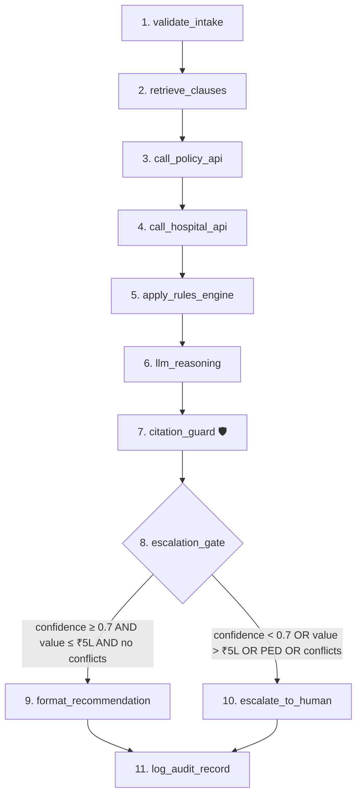

# Member 2 — Retrieval, Rules & Orchestration Engineer
## Implementation Plan (v2 — updated with Guardrails + Metrics)

> [!IMPORTANT]
> **v2 changes**: Plan updated after cross-referencing with [Guardrails.md](file:///Users/arunkumardhanasekaran/VS_code/LLM_Project/Guardrails.md) (7 mandatory governance guardrails) and [Metrics.md](file:///Users/arunkumardhanasekaran/VS_code/LLM_Project/Metrics.md) (9-dimension evaluation rubric). Changes marked with 🆕.

---

## ✅ Guardrail Compliance Matrix 🆕

| # | Guardrail | How We Enforce It |
|---|-----------|-------------------|
| 1 | **Recommend, never decide** | `AdjudicationResult.recommendation` is always `RECOMMEND_AUTHORISE` / `RECOMMEND_QUERY` / `RECOMMEND_DENY` — the word "recommend" is baked into the enum. The LangGraph `format_recommendation` node explicitly labels output as "RECOMMENDATION — requires human sign-off". No auto-approve path exists in the graph. |
| 2 | **Grounded output or no output** | `citation_guard` is a **non-bypassable graph node** (not just a post-processing step). Every `Deduction` object requires a non-empty `clause_citation` + `source_file`. The LLM reasoning node's output is verified against `retrieved_clauses` — any unmatched citation is stripped and logged as a hallucination. |
| 3 | **Synthetic data only** | All policy wordings and IRDAI documents in `retrieval/corpus/` are synthetic. Generator script is documented. No real policyholder data ever enters the pipeline. |
| 4 | **Deployment note** | Member 3 owns this, but our orchestration code logs token counts + latency per call to feed the cost analysis. |
| 5 | **Fairness** | Rules engine uses **only** risk-relevant features: `diagnosis`, `procedure`, `policy terms`, `admission_date`. Never reads `patient.full_name`, `hospital.city` as decision proxies. A `fairness_check()` function validates that no protected-proxy attributes influenced the output. 🆕 |
| 6 | **Cite the live text** | Every IRDAI document in `retrieval/corpus/irdai_circulars/` carries the circular number + gazette date (e.g., "IRDAI/HLT/CIR/MISC/XXX/05/2024, dated 29-May-2024"). Retrieved clauses carry this metadata through to the final recommendation. 🆕 |
| 7 | **Human-in-the-loop** | Escalation triggers are explicit and documented: (a) confidence < 0.7, (b) claim value > ₹5,00,000, (c) PED-flagged diagnosis, (d) conflicting clauses detected, (e) non-network hospital. The human sees: full `DecisionRecord`, retrieved clauses, rule trace, and the agent's reasoning. Override capture is logged. 🆕 |

---

## 📊 Metrics Integration Matrix 🆕

Every dimension from [Metrics.md](file:///Users/arunkumardhanasekaran/VS_code/LLM_Project/Metrics.md) has a concrete measurement hook:

| Dimension | Where Measured | Instrument |
|-----------|---------------|------------|
| **Extraction accuracy** | Member 1's domain — but our pipeline logs extraction confidence from `IntakeResult.confidence_score` | Field-level P/R from intake |
| **Retrieval quality** | `retrieval/vector_store.py` → `evaluate_recall_at_k()` | Recall@5 on 20+ labelled queries |
| **Grounding fidelity** | `orchestration/nodes.py` → `citation_guard()` node | % citations traceable to retrieved clauses; hallucination count |
| **Decision accuracy** | `rules/engine.py` output vs. expert-labelled golden set | Agreement % on 100+ cases |
| **Escalation precision** | `orchestration/nodes.py` → `escalation_gate()` | True positive / false positive escalation rate |
| **Latency** | `@track_latency` decorator on every graph node | End-to-end wall-clock time per claim |
| **Cost** | Token counter in `llm_reasoning()` node | Tokens + ₹ per transaction |
| **Robustness** | 8 mandatory adversarial cases in test suite | Pass/fail + behaviour description |
| **Fairness** | `rules/engine.py` → `fairness_check()` | Outcome stability when name/city/gender perturbed |

---

## 🏗️ Directory Structure

```
LLM_Project/
├── retrieval/                           # ← NEW: Clause retrieval system
│   ├── __init__.py                      # Public API: retrieve_clauses()
│   ├── embedder.py                      # Document chunking + embedding generation
│   ├── vector_store.py                  # FAISS index build / load / query
│   └── corpus/                          # Policy wording + IRDAI documents (text)
│       ├── policy_wordings/             # Synthetic policy wording documents
│       ├── benefit_tables/             # Benefit schedule / sub-limit tables
│       ├── irdai_circulars/            # IRDAI non-payables list, master circular excerpts
│       └── generate_corpus.py          # Script to generate synthetic policy corpus
│
├── rules/                               # ← NEW: Deterministic rules engine
│   ├── __init__.py                      # Public API: apply_rules()
│   ├── engine.py                        # Master rules orchestrator
│   ├── waiting_period.py                # Waiting-period check logic
│   ├── sub_limits.py                    # Sub-limit and room-rent capping
│   ├── copay_deductible.py             # Co-pay and deductible calculations
│   ├── exclusions.py                   # IRDAI exclusion & non-payable checks
│   ├── policy_validity.py             # Policy active/lapsed/expired checks
│   ├── fairness.py                    # 🆕 Fairness verification — no proxy usage
│   └── models.py                       # RuleResult, Deduction, AdjudicationResult
│
├── orchestration/                       # ← NEW: Agent graph + mock APIs
│   ├── __init__.py                      # Public API: run_pipeline()
│   ├── graph.py                         # LangGraph state-machine definition
│   ├── nodes.py                         # Individual graph node functions
│   ├── state.py                         # PipelineState TypedDict for LangGraph
│   ├── metrics.py                      # 🆕 Latency + cost tracking decorators
│   └── mock_api/                       # FastAPI mock core systems
│       ├── __init__.py
│       ├── app.py                      # FastAPI app definition
│       ├── policy_admin.py            # GET /api/policy/{id}/status etc.
│       └── claims_system.py           # GET /api/claims/sub-limit-balance etc.
│
├── schemas/                             # EXISTING (Member 1) — untouched
├── intake/                              # EXISTING (Member 1) — consumed, not modified
└── data/                                # EXISTING (Member 1) — consumed, not modified
```

---

## 📋 Phase-by-Phase Breakdown

### Phase 1 · Policy Corpus & Retrieval Baseline (Week 3–4)

**Goal**: Searchable knowledge base of policy wordings + IRDAI regulations with clause-level citations.

| Step | File | Detail |
|------|------|--------|
| 1A | `retrieval/corpus/generate_corpus.py` | Generate ~20 synthetic policy wordings covering 8 clinical scenarios. **Each document carries circular/gazette date** (Guardrail #6) |
| 1B | `retrieval/embedder.py` | Chunk docs (~300-500 tokens, overlapping). Tag each chunk with `{source_file, section, circular_date, chunk_id}` |
| 1C | `retrieval/vector_store.py` | FAISS index — `build_index()`, `search()`, `evaluate_recall_at_k()` |
| 1D | `retrieval/__init__.py` | Public API: `retrieve_clauses(request, top_k=5) → list[RetrievedClause]` |

### Phase 2 · Rules Engine (Week 5–6)

**Goal**: Deterministic adjudication. Every deduction cites a clause (Guardrail #2). Only risk-relevant features used (Guardrail #5).

| Module | Logic |
|--------|-------|
| `policy_validity.py` | Active/lapsed/expired check; admission within policy period |
| `waiting_period.py` | 30-day initial; 2-year specific disease; 4-year PED |
| `sub_limits.py` | Room-rent capping + proportionate deduction |
| `copay_deductible.py` | Co-pay %; top-up/super-top-up deductibles |
| `exclusions.py` | IRDAI non-payable items (List I–IV); permanent exclusions |
| `fairness.py` 🆕 | Verify no protected-proxy attributes influenced output |
| `engine.py` | Sequential orchestrator → `AdjudicationResult` with `RECOMMEND_*` enum (Guardrail #1) |

### Phase 3 · Mock Core System APIs (Week 5–6, parallel)

| Endpoint | Returns |
|----------|---------|
| `GET /api/policy/{id}/status` | `{status, remaining_sum_insured, co_pay_pct}` |
| `GET /api/policy/{id}/waiting-period` | `{initial_wp_clear, specific_disease_wp_clear, ped_wp_clear, days_elapsed}` |
| `GET /api/policy/{id}/sub-limit-balance` | `{limits: {...}, consumed: {...}}` |
| `GET /api/hospital/{id}/empanelment` | `{is_empanelled, tier, agreed_room_rate}` |

### Phase 4 · Agent Orchestration — LangGraph (Week 7–8)



> [!CAUTION]
> **Node 7 (`citation_guard`)** is non-bypassable per Guardrail #2. It cross-checks every clause reference in the LLM output against `retrieved_clauses`. Hallucinated citations are stripped, logged, and counted toward the Grounding Fidelity metric.

### Phase 5 · Adversarial Tuning & Profiling (Week 9–10)

All 8 mandatory adversarial cases + latency/cost profiling + fairness perturbation tests.

### Phase 6 · Polish & Integration (Week 11–12)

End-to-end smoke test on 220 cases, integration with Member 3's audit/escalation modules.

---

## 🚦 Build Order (Starting Now)

| Priority | What to Build | Status |
|----------|--------------|--------|
| **1st** | `retrieval/vector_store.py` — FAISS index core | 🔨 Building now |
| **2nd** | `retrieval/embedder.py` — stub | 🔨 Building now |
| **3rd** | `retrieval/__init__.py` — public API stub | 🔨 Building now |
| **4th** | `rules/models.py` — Pydantic models for adjudication | 🔨 Building now |
| **5th** | `rules/engine.py` — stub | 🔨 Building now |
| **6th** | `rules/*.py` — individual rule module stubs | 🔨 Building now |
| **7th** | `orchestration/state.py` — pipeline state stub | 🔨 Building now |
| **8th** | `orchestration/mock_api/app.py` — FastAPI stub | 🔨 Building now |
| **9th** | `orchestration/metrics.py` — latency/cost tracking | 🔨 Building now |
