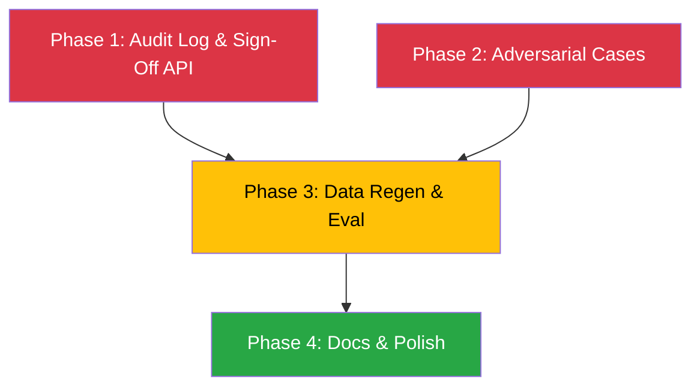

# Final Implementation Plan — Complete All Missing Work

> **Scope**: Guardrail #7 fix + all missing functionality (excl. Guardrail #4 Deployment Note)
> **Estimated effort**: ~8 hours across 4 phases

---

## Phase 1 — Immutable Audit Log & Human Sign-Off (Guardrail #7)

> **Why**: The project plan mandates an "immutable audit log" recording every input, retrieved clause, computation, recommendation, and human override. Currently `format_recommendation` builds a `decision_record` dict but **never persists it**. The frontend "Sign-off Review" button has **no backend**.

### Step 1.1 — Create `audit/` module

Create 3 files:

| File | Purpose |
|------|---------|
| `audit/__init__.py` | Public API: `log_record()`, `get_record()`, `list_records()`, `record_override()` |
| `audit/models.py` | Pydantic models: `AuditRecord`, `HumanOverride` |
| `audit/store.py` | Append-only JSONL store with SHA-256 hash chaining |

**`AuditRecord` model** (what gets persisted per claim):

```python
class AuditRecord(BaseModel):
    record_id: str                    # UUID — unique per pipeline run
    request_id: str                   # Links to PreAuthRequest.request_id
    timestamp: datetime               # When the pipeline completed
    
    # Inputs
    intake_summary: dict              # Condensed intake result (patient, policy, diagnosis, cost)
    source_format: str                # json / pdf / scanned_pdf / image / docx / text
    
    # Retrieval
    retrieved_clauses: list[dict]     # Clause text + source_file + similarity score
    
    # Adjudication
    recommendation: str               # RECOMMEND_AUTHORISE / QUERY / DENY
    confidence: float
    total_claimed: str                # INR as string (Decimal serialization)
    total_approved: str
    total_deducted: str
    deductions: list[dict]            # Each with clause_citation + source_document
    reasoning_narrative: str          # Full LLM or fallback narrative
    
    # Escalation
    needs_escalation: bool
    escalation_triggers: list[str]
    
    # Citation integrity
    hallucinated_citations: list[str]
    
    # Metrics
    latencies: dict[str, float]       # Per-node wall-clock times
    total_latency: float
    llm_tokens: dict[str, int]
    llm_cost_inr: float
    
    # Hash chain (tamper evidence)
    previous_hash: str                # SHA-256 of the previous record
    record_hash: str                  # SHA-256 of this record (excl. this field)
    
    # Human override (initially None, populated by sign-off endpoint)
    human_override: Optional[HumanOverride] = None
```

**`HumanOverride` model**:

```python
class HumanOverride(BaseModel):
    reviewer_id: str
    action: str                       # "APPROVE" / "DENY" / "SEND_BACK"
    override_reason: str
    timestamp: datetime
    original_recommendation: str      # What the system recommended
```

**`AuditStore` class** (in `audit/store.py`):

```python
class AuditStore:
    """Append-only JSONL store with SHA-256 hash chain."""
    
    def __init__(self, log_path: str = "data/audit_log.jsonl"):
        ...
    
    def append(self, record: AuditRecord) -> AuditRecord:
        """Append a record. Computes hash chain. Returns record with hashes set."""
    
    def get(self, record_id: str) -> Optional[AuditRecord]:
        """Retrieve a single record by ID."""
    
    def list_all(self) -> list[AuditRecord]:
        """List all records (most recent first)."""
    
    def record_override(self, record_id: str, override: HumanOverride) -> AuditRecord:
        """Append a NEW record that references the original + the override.
        Does NOT mutate the original (append-only)."""
    
    def verify_chain(self) -> tuple[bool, list[str]]:
        """Verify the entire hash chain. Returns (is_valid, error_messages)."""
```

> [!IMPORTANT]
> **Append-only guarantee**: The store NEVER modifies existing lines. A human override appends a new record referencing the original `record_id`. This satisfies "immutable audit log" and "how disagreement is captured for future improvement."

---

### Step 1.2 — Add `log_audit_record` node to LangGraph

| File | Change |
|------|--------|
| [`orchestration/nodes.py`](file:///Users/arunkumardhanasekaran/VS_code/LLM_Project/orchestration/nodes.py) | Add new `log_audit_record()` function at the end |
| [`orchestration/graph.py`](file:///Users/arunkumardhanasekaran/VS_code/LLM_Project/orchestration/graph.py) | Add node after `format_recommendation`, wire `format_recommendation → log_audit_record → END` |

The node will:
1. Read the `decision_record` from state
2. Build an `AuditRecord` from it
3. Call `AuditStore.append(record)` 
4. Write `audit_record_id` back to state

---

### Step 1.3 — Add API endpoints to `main.py`

| Endpoint | Method | Purpose |
|----------|--------|---------|
| `/api/v1/preauth/queue` | `GET` | List all processed claims from the audit log (for the review queue) |
| `/api/v1/preauth/{record_id}` | `GET` | Get a single claim's full audit record |
| `/api/v1/preauth/{record_id}/sign-off` | `POST` | Submit human reviewer sign-off (approve/deny/send-back with reason) |
| `/api/v1/audit/verify` | `GET` | Verify the entire audit log hash chain integrity |

**Sign-off request body**:
```json
{
    "reviewer_id": "dr_patel_01",
    "action": "APPROVE",
    "override_reason": "Reviewed clinical notes — PED waiver applicable under renewal terms."
}
```

---

### Step 1.4 — Wire the frontend to real APIs

| File | Change |
|------|--------|
| [`frontend/src/App.tsx`](file:///Users/arunkumardhanasekaran/VS_code/LLM_Project/frontend/src/App.tsx) | Replace `mockQueue` with `GET /api/v1/preauth/queue` fetch |
| [`frontend/src/App.tsx`](file:///Users/arunkumardhanasekaran/VS_code/LLM_Project/frontend/src/App.tsx) | Wire "Sign-off Review" button to `POST /api/v1/preauth/{id}/sign-off` |
| [`frontend/src/App.tsx`](file:///Users/arunkumardhanasekaran/VS_code/LLM_Project/frontend/src/App.tsx) | Wire "Immutable Audit Log" tab to `GET /api/v1/preauth/{id}` and display real hash chain |

---

### Step 1.5 — Add CORS middleware

| File | Change |
|------|--------|
| [`main.py`](file:///Users/arunkumardhanasekaran/VS_code/LLM_Project/main.py) | Add `CORSMiddleware` for `http://localhost:5173` (Vite dev server) |

---

### Step 1.6 — Unit tests for audit log

| File | Tests |
|------|-------|
| `tests/test_audit.py` | `test_append_creates_file`, `test_hash_chain_integrity`, `test_override_appends_new_record`, `test_get_by_id`, `test_list_all_returns_newest_first`, `test_tampered_record_fails_verification` |

---

## Phase 2 — Missing Mandatory Adversarial Cases

> **Why**: The rubric in Section 9 of the project plan requires 8 specific adversarial cases. Three are missing.

### Step 2.1 — Endorsement Reversal (Adversarial #4)

| Task | File |
|------|------|
| Create a policy endorsement document that **contradicts** the base policy wording (e.g., a rider that extends PED waiting period from 48 months to 12 months, or waives a specific exclusion) | `retrieval/corpus/policy_wordings/endorsement_reversal_rider.txt` |
| Add 3-5 adversarial test cases where the endorsement should override the base clause | `scripts/generate_synthetic_data.py` — new subtype `endorsement_reversal` |
| Test that the retrieval system surfaces **both** the base clause and the endorsement, and the rules engine / LLM picks the endorsement | Integration test in `tests/test_pipeline.py` |

---

### Step 2.2 — Hindi / Unexpected Language Document (Adversarial #5)

| Task | File |
|------|------|
| Add a Hindi/Devanagari medical note template to the document renderer | `scripts/render_synthetic_documents.py` — new function `_render_hindi_txt()` |
| Generate 2-3 test cases with Hindi text | `scripts/generate_synthetic_data.py` — new subtype `unexpected_language` |
| Verify the intake pipeline handles it gracefully (either OCR extracts it or returns low confidence with appropriate error) | `intake/extractors/ocr_handler.py` — add language detection / graceful fallback |

> [!NOTE]
> The goal is NOT perfect Hindi OCR. The goal is **graceful degradation** — the system should detect it can't parse the document confidently and either flag it for human review or return a low-confidence result with `RECOMMEND_QUERY`.

---

### Step 2.3 — Illegible Scan (Adversarial #6)

| Task | File |
|------|------|
| Add image degradation function (Gaussian blur, JPEG compression artifacts, low DPI simulation) | `scripts/render_synthetic_documents.py` — new function `_degrade_image()` |
| Generate 2-3 deliberately illegible scan test images | Outputs to `data/synthetic_docs/images/` |
| Add OCR confidence rejection gate — if OCR confidence < threshold, flag as `RECOMMEND_QUERY` with reason "illegible document" | `intake/extractors/ocr_handler.py` |
| New subtype in golden test set | `scripts/generate_synthetic_data.py` — subtype `illegible_scan` |

---

## Phase 3 — Data Regeneration & Evaluation Run

> **Depends on**: Phase 1 (audit node must exist) and Phase 2 (new adversarial cases must be in generator)

### Step 3.1 — Regenerate everything

```bash
# 1. Regenerate 210+ case golden test set (now includes endorsement_reversal, unexpected_language, illegible_scan)
python scripts/generate_synthetic_data.py

# 2. Re-render documents (PDF, DOCX, PNG, TXT + Hindi + degraded images)
python scripts/render_synthetic_documents.py

# 3. Rebuild FAISS index (now includes endorsement_reversal_rider.txt)
python -c "from retrieval.vector_store import VectorStore; vs = VectorStore(); vs.build_index()"
```

### Step 3.2 — Run evaluations

```bash
# 4. Full 9-dimension evaluation → data/evaluation_results.json
python scripts/evaluate_pipeline.py

# 5. Fairness perturbation tests → data/fairness_results.json
python scripts/evaluate_fairness.py
```

### Step 3.3 — Review results

- Check all 9 dimensions against thresholds in [`Metrics.md`](file:///Users/arunkumardhanasekaran/VS_code/LLM_Project/Metrics.md)
- Verify confusion matrix reports both FP and FN rates
- Confirm all 11 adversarial subtypes have results in robustness breakdown

---

## Phase 4 — Documentation & Polish

### Step 4.1 — Governance Write-Up (Guardrail #6)

Create `docs/governance_writeup.md` with:

| Section | Content |
|---------|---------|
| **Guardrail 1** | Cite `Recommendation` enum design + `format_recommendation` node |
| **Guardrail 2** | Cite `citation_guard` node as non-bypassable |
| **Guardrail 3** | Reference `scripts/generate_synthetic_data.py` and the DPDP Act 2023 |
| **Guardrail 4** | Reference deployment note (deferred — placeholder) |
| **Guardrail 5** | Cite `rules/fairness.py` + `evaluate_fairness.py` results |
| **Guardrail 6** | Cite the **3 live IRDAI instruments** with exact references |
| **Guardrail 7** | Cite `audit/` module, escalation triggers list, sign-off API |

**Live IRDAI citations to include**:

| Document | Reference | Date |
|----------|-----------|------|
| Master Circular on Health Insurance | `IRDAI/HLT/CIR/MISC/116/05/2024` | 29-May-2024 |
| Cashless Timeline Enforcement | Chapter VI, Sections 36–38 of the above | 29-May-2024 |
| Non-Payable Items Schedule | Chapter IX, Section 52 of the above | 29-May-2024 |

> [!NOTE]
> These are already in your corpus files. The governance doc just formalizes them as explicit citations.

---

### Step 4.2 — Update documentation

| File | Update |
|------|--------|
| [`README.md`](file:///Users/arunkumardhanasekaran/VS_code/LLM_Project/README.md) | Add audit log, sign-off API, new adversarial cases to project structure & docs |
| [`UptoNow.md`](file:///Users/arunkumardhanasekaran/VS_code/LLM_Project/UptoNow.md) | Add sections for Audit Log module, new API endpoints, adversarial cases |
| [`todo.md`](file:///Users/arunkumardhanasekaran/VS_code/LLM_Project/todo.md) | Move remaining items to ✅ COMPLETED |

---

## Dependency Graph



> **Phases 1 & 2 are independent** — can be built in parallel.
> **Phase 3** needs both complete (new audit node + new adversarial corpus).
> **Phase 4** is documentation after eval numbers exist.

---

## Build Order Summary

| Order | What | Files Created/Modified | Est. Time |
|-------|------|----------------------|-----------|
| **1** | `audit/models.py` | New | 20 min |
| **2** | `audit/store.py` | New | 40 min |
| **3** | `audit/__init__.py` | New | 10 min |
| **4** | `orchestration/nodes.py` — `log_audit_record` node | Modified | 20 min |
| **5** | `orchestration/graph.py` — wire new node | Modified | 10 min |
| **6** | `main.py` — queue + sign-off + verify endpoints + CORS | Modified | 40 min |
| **7** | `tests/test_audit.py` | New | 30 min |
| **8** | `frontend/src/App.tsx` — wire to real APIs | Modified | 30 min |
| **9** | `retrieval/corpus/.../endorsement_reversal_rider.txt` | New | 20 min |
| **10** | `scripts/generate_synthetic_data.py` — new subtypes | Modified | 30 min |
| **11** | `scripts/render_synthetic_documents.py` — Hindi + degraded | Modified | 40 min |
| **12** | `intake/extractors/ocr_handler.py` — rejection gate | Modified | 20 min |
| **13** | Run data regen + eval scripts | Commands | 30 min |
| **14** | `docs/governance_writeup.md` | New | 30 min |
| **15** | Update README, UptoNow, todo | Modified | 20 min |
